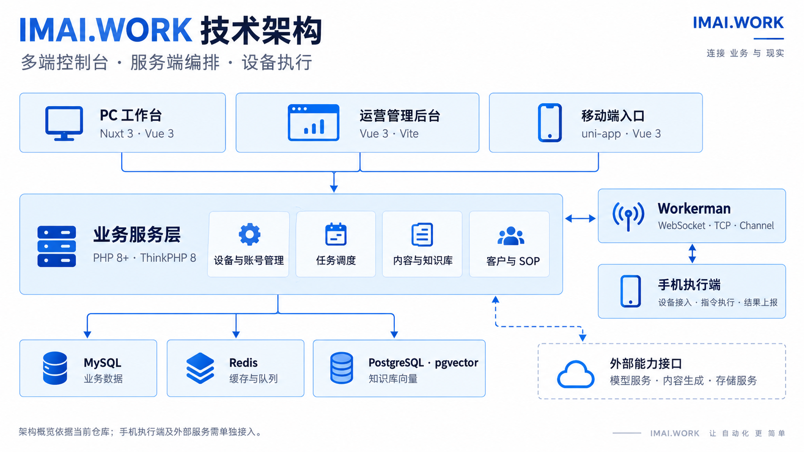
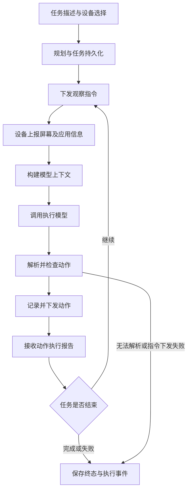
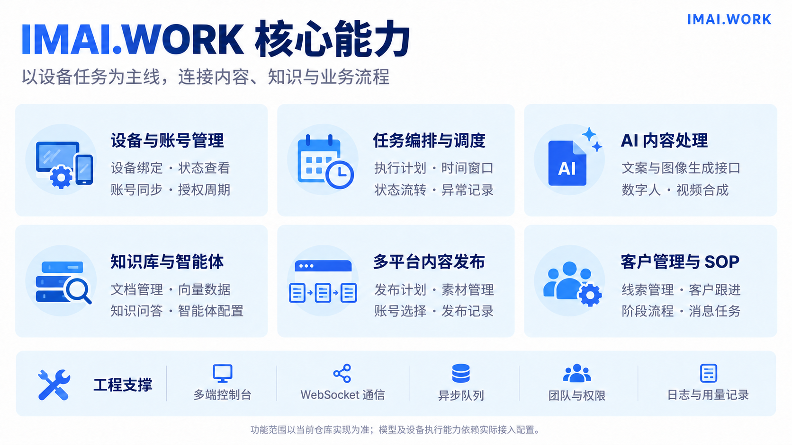
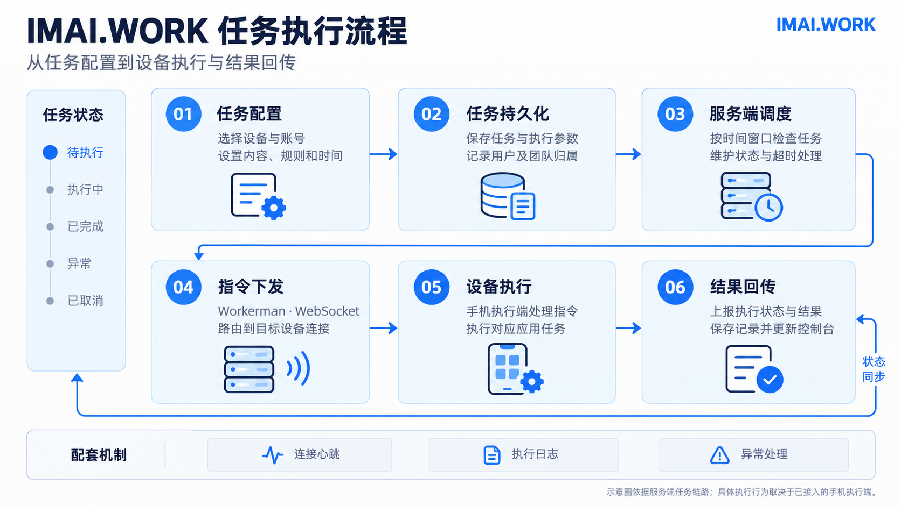
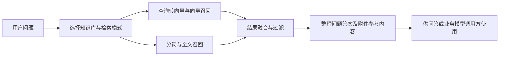
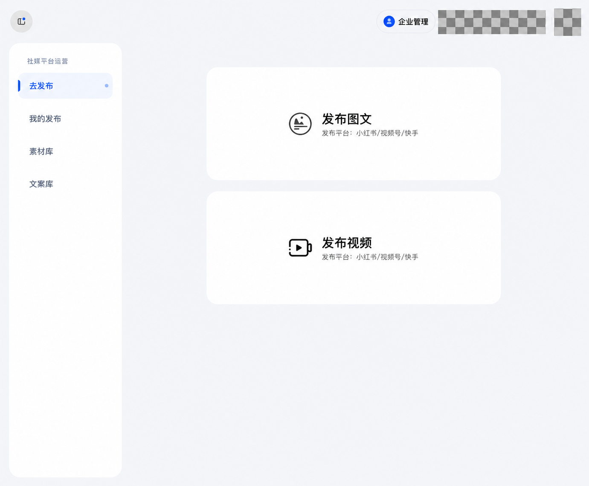
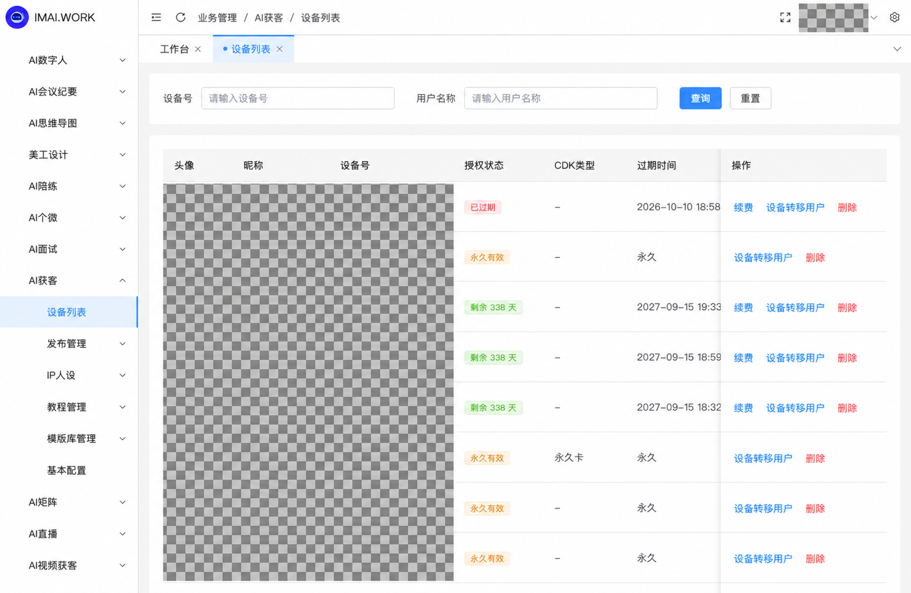

# IMAI.WORK AI Phone

**集成 Phone Agent、设备任务调度、AI 内容处理与业务流程协作的自动化平台。**

IMAI.WORK 采用多端控制台、服务端任务编排与手机执行端协作的架构，将设备管理、账号同步、任务调度、AI 内容处理、知识库和客户流程整合到统一的业务系统中。系统同时包含两条执行链路：一条按设备、账号、内容和时间规则调度业务任务；另一条由 Phone Agent 根据任务描述与设备观察信息调用模型、解析动作，并通过设备通信服务组织多轮执行。

在 Phone Agent 链路中，服务端负责规划结果、任务状态、观察数据、模型轮次、动作记录与执行事件，手机执行端负责提供屏幕及应用信息、接收操作指令和上报执行结果。内容生成、知识检索、发布计划及客户 SOP 则为具体业务场景提供配套能力。

本仓库包含 PHP 服务端、PC 工作台、运营管理后台和 uni-app 移动端代码。手机执行端及外部模型、内容生成等服务的接入条件应与平台代码分别说明。

[前台演示](https://demo.imai.work/) · [后台演示](https://demo.imai.work/admin/) · [技术文档与图片索引](./docs/README.md)

## 阅读导航

- [系统架构](#系统架构)：各端职责、数据存储和通信组件。
- [两种任务执行模式](#两种任务执行模式)：业务任务调度与 Phone Agent 的适用方式。
- [Phone Agent 实现](#phone-agent-实现)：规划、观察、模型调用、动作解析和事件记录。
- [设备通信与消息处理](#设备通信与消息处理)：连接管理、协议字段和 Handler 分发。
- [核心能力](#核心能力)：设备、内容、发布和客户流程。
- [任务执行链路](#任务执行链路)：任务关系、状态定义和调度机制。
- [知识库与模型服务](#知识库与模型服务)：向量、全文及混合召回。
- [异步任务与媒体处理](#异步任务与媒体处理)：队列、转码与恢复入口。
- [用户团队与访问控制](#用户团队与访问控制)：登录、管理权限和资源归属。
- [界面展示](#界面展示)：脱敏后的演示站页面。
- [代码目录](#代码目录)：源码组织及阅读路径。
- [开发与部署入口](#开发与部署入口)：环境配置、构建和常驻进程。
- [运行诊断与扩展方式](#运行诊断与扩展方式)：排查方向和扩展位置。
- [实现与接入范围](#实现与接入范围)：源码实现与运行验证的范围。

## 系统架构



系统按交互入口、业务服务、设备通信与数据存储划分职责：

| 层次 | 技术与实现 | 职责 |
| --- | --- | --- |
| PC 工作台 | Nuxt 3、Vue 3、TypeScript、Element Plus | 设备、任务、内容、知识库及客户业务入口 |
| 运营管理后台 | Vue 3、Vite、TypeScript、Element Plus | 平台配置、业务管理、用户及权限管理 |
| 移动端 | uni-app、Vue 3 | H5、小程序等移动交互入口 |
| 业务服务 | PHP 8+、ThinkPHP 8、ThinkORM | 接口校验、业务逻辑、数据持久化与任务编排 |
| 设备通信 | Workerman、WebSocket、TCP、Channel | 连接管理、消息路由及跨进程通信 |
| 缓存与队列 | Redis、Think Queue | 缓存、连接状态及异步任务处理 |
| 业务存储 | MySQL | 设备、账号、任务、用户、团队及业务记录 |
| 知识库存储 | PostgreSQL、pgvector | 知识分段、向量及相关检索数据 |
| 外部能力 | 模型、内容生成及对象存储接口 | 根据实际配置调用相应服务 |

技术版本以各端依赖文件和部署要求为准；上表描述当前仓库的实现组成，不代表所有模块均已完成独立部署验证。

Web 接口、设备通信、队列消费和定时调度是不同的运行单元。部署 Web 页面和 PHP 接口后，还需要运行对应后台进程，才能处理设备指令、异步任务和时间窗口调度。MySQL 保存主要业务关系，Redis 维护缓存、队列及连接映射，PostgreSQL 承载知识库向量与全文检索数据。

## 两种任务执行模式

| 对比项 | 按计划调度的业务任务 | Phone Agent 任务 |
| --- | --- | --- |
| 任务入口 | 选择设备、账号、素材、业务场景和执行时间 | 输入任务描述并选择设备，可携带规划及模型参数 |
| 执行依据 | 已配置的业务参数、任务类型和时间窗口 | 任务目标、当前观察信息及模型返回动作 |
| 服务端核心 | `DeviceTaskScheduler`、`DeviceAutoTaskScheduler` 及业务处理逻辑 | `PhoneAgentStateService` 及规划、模型、解析、下发服务 |
| 执行组织 | 按任务类型调用对应处理逻辑 | 多轮观察、推理、动作执行及结果上报 |
| 数据记录 | 设备任务、业务子任务、发布记录等 | 会话、任务、轮次、观察、动作及事件 |
| 适用场景 | 内容发布、客户互动、账号相关任务等重复流程 | 需要结合当前屏幕信息逐步推进的手机任务 |

这两条链路共用设备接入与消息通信基础，但拥有各自的任务模型和状态定义。业务任务的数字状态与 Phone Agent 的字符串状态不能直接混用。

## Phone Agent 实现

### 服务职责

Phone Agent 位于 `server/app/common/service/phoneAgent/`，相关 API 位于 `server/app/api/controller/phoneAgent/`。当前代码将执行过程拆分为以下职责：

| 组件 | 职责 |
| --- | --- |
| `PhoneAgentLogic` | 校验设备归属、创建任务与会话、查询详情、取消任务 |
| `PhoneAgentPlanningService` | 分析任务描述，整理规划内容和执行文本 |
| `PhoneAgentStateService` | 推进执行轮次，处理观察及动作报告，维护任务终态 |
| `PhoneAgentMessageBuilder` | 构建执行模型所需的系统提示和当前任务信息 |
| `PhoneAgentModelContextService` | 整理截图、OCR、无障碍树、当前应用和动作历史 |
| `PhoneAgentModelRequestService` | 组装模型请求并调用外部模型接口 |
| `PhoneAgentActionParserService` | 将模型输出转换为服务端可处理的动作结构 |
| `PhoneAgentActionPolicy` | 定义允许的动作类型 |
| `PhoneAgentDispatchService` | 检查在线状态，下发观察、执行、取消消息并保存事件 |
| `PhoneAgentBillingService` | 模型调用前的余额检查与用量计费处理 |
| `PhoneAgentReportHandler` | 接收设备报告，补充连接信息后交给状态服务 |

这些职责位于服务端；观察信息如何采集、坐标如何映射到手机屏幕及动作如何执行，需要结合实际手机执行端。

### 观察与执行循环



具体处理过程包括：

1. **创建任务**：校验所选设备属于当前用户，检查模型相关余额，生成任务标识，并在事务中保存会话与任务。
2. **准备规划**：根据 `skip_analyze`、`execution_message` 和规划模型参数决定如何构建执行任务。代码分别保存原始描述、执行文本和规划结果。
3. **请求观察**：下发截图、OCR 和无障碍树等观察需求；第一轮观察还携带回到桌面的标记。
4. **组织上下文**：整理当前应用、观察信息、执行提示与前序动作信息，为模型构建本轮请求。
5. **解析动作**：兼容函数调用、JSON、部分文本动作表达式和坐标输出，并将结果规范化。
6. **下发执行**：记录轮次、动作序号、动作参数及消息内容，更新为等待设备报告的状态。
7. **处理报告**：校验报告对应的设备、轮次和动作，记录成功或失败；有后续动作时继续下发，否则按执行结果进入后续观察或结束任务。

代码中的观察上下文整理会限制 OCR 文本与无障碍树规模，执行状态服务当前将最大执行轮次设为 **20**。这些限制属于当前实现参数，不是对任意任务完成率的承诺。

### 动作协议

当前动作白名单包含以下操作：

| 动作 | 服务端语义 |
| --- | --- |
| `launch` | 启动应用 |
| `tap`、`double_tap`、`long_press` | 点击、双击与长按 |
| `type` | 输入文本 |
| `swipe` | 滑动 |
| `wait` | 等待 |
| `back`、`home` | 返回及回到桌面 |
| `take_over` | 接管类动作 |
| `finish` | 结束执行 |

执行消息携带 `task_id`、`turn_no`、`action_no`、`action_type`、`params` 和 `timeout`。坐标约定为 `normalized_1000`；执行端需要按双方协议将其转换到实际设备坐标。

模型返回动作类型不能直接视为执行成功。服务端仍需解析输出、检查动作、下发指令并接收设备报告。当前解析器还包含搜索场景结束检查及重复动作相关处理，但这些规则不等同于通用任务完成验证。

### 任务状态与数据记录

`PhoneAgentTask` 定义以下状态：

| 状态 | 含义 |
| --- | --- |
| `created` | 任务已创建 |
| `observing` | 正在组织设备观察 |
| `model_pending` | 正在请求模型 |
| `dispatching` | 模型中预留的指令下发状态 |
| `waiting_report` | 已下发动作，等待报告 |
| `completed` | 已完成 |
| `failed` | 执行失败 |
| `canceled` | 已取消 |

`completed`、`failed`、`canceled` 为终态。实际状态写入以 `PhoneAgentStateService` 的执行分支为准，并非每个任务都会经过所有定义状态。

执行数据分别由 `PhoneAgentConversation`、`PhoneAgentTask`、`PhoneAgentTurn`、`PhoneAgentObservation`、`PhoneAgentAction` 和 `PhoneAgentEvent` 保存。任务详情可关联查询各轮模型响应、设备观察、动作与事件；事件查询支持 `last_id` 和 `limit`，便于增量获取。

对已结束任务的迟到报告、轮次不匹配报告、设备不匹配报告和已处理动作，状态服务包含单独的记录或忽略分支。这能保留排查上下文，但不能据此宣称整条链路已具备严格的“恰好一次”执行语义。

### API 方法入口

| 方法 | 用途 | 主要参数 |
| --- | --- | --- |
| `devices` | 获取用户可选择设备 | 当前登录用户 |
| `analyze` | 分析任务描述 | `message`、`analyze_model`、`lang` |
| `dispatch` | 创建并启动任务 | `message`、`device_code`、`model`，可携带会话与规划参数 |
| `detail` | 查看单个任务详情 | `task_id` |
| `events` | 增量查询任务事件 | `task_id`、`last_id`、`limit` |
| `history`、`conversationDetail` | 查看历史与会话详情 | 分页参数或 `conversation_id` |
| `cancel` | 取消任务 | `task_id` |
| `deleteConversation` | 删除会话 | `conversation_id` |

上表来自控制器及校验器，描述方法职责。具体 HTTP 路径应以部署后的 ThinkPHP 路由及前端调用为准；本次未向这些接口提交执行或计费请求。

## 设备通信与消息处理

### 连接与路由

`workerman:server` 命令创建 RPA WebSocket、微信 WebSocket、设备 TCP 和内部 Channel 服务。当前代码默认端口如下，部署时可通过环境变量调整：

| 通道 | 默认监听 | 配置项 | 作用 |
| --- | --- | --- | --- |
| Channel | `127.0.0.1:2206` | `WORKERMAN.CHANNEL_PROT` | 内部进程之间传递消息 |
| RPA WebSocket | `0.0.0.0:2345` | `WORKERMAN.RPA_PORT` | RPA 设备及控制台消息 |
| 微信 WebSocket | `0.0.0.0:2347` | `WORKERMAN.WECHAT_PORT` | 微信业务消息 |
| 设备 TCP | `0.0.0.0:6489` | `WORKERMAN.DEVICE_PORT` | 对应设备协议接入 |

`CHANNEL_PROT` 是当前代码中的实际拼写。前台 `useDeviceWs` 使用 `wss://当前域名/wss`，生产 Web 服务需要将该入口代理到相应设备通信服务。

`ConnectionRepository` 在 Redis 中维护连接与 Worker、设备与连接的映射。`ChannelBus` 用于进程间投递，避免 Web 请求进程或其他 Worker 直接依赖某个进程的本地连接对象。

### 消息结构

设备 WebSocket 消息使用 JSON，主要字段包括：

| 字段 | 作用 |
| --- | --- |
| `type` | 消息或指令类型，可为协议数字或指定字符串 |
| `deviceId` | 目标或来源设备标识 |
| `content` | 业务参数、报告内容或查询条件 |
| `messageId` | 消息关联标识 |
| `appType` | 应用类型 |
| `appVersion` | 消息携带的协议或客户端版本 |
| `code`、`reply` | 响应状态及内容，按具体处理器返回 |

Phone Agent 指令在 `WorkerEnum` 中对应 `1100` 执行、`1101` 上报、`1102` 取消和 `1103` 观察。其他业务任务拥有各自消息类型，应使用项目枚举进行对接。

### 服务端接收流程

接收到消息后，`RpaSocketService` 更新心跳时间、解析 JSON，经 `MessageValidator` 校验后交给 `HandlerRegistry`。注册表按消息类型选择设备、发布、私信、任务报告或 Phone Agent 等处理器。

校验逻辑包含必要字段检查、设备在线检查和部分设备接入鉴权。心跳与初始化消息存在专门处理分支；不同消息类型的校验条件不同，不能把设备接入校验理解为所有 API 都采用同一认证方式。

连接关闭时，服务会处理旧连接与新连接的归属关系、在线状态及重复关闭回调；部分在线标记异常也可根据仍在使用的设备连接进行修复。

## 核心能力



### 设备与账号管理

提供设备绑定、状态查看、账号同步、授权周期及设备任务管理入口。服务端维护设备与用户归属、账号关联和连接信息，为按设备路由任务提供基础。

设备、账号和任务分别维护：一台设备可关联相应应用账号，业务任务进一步记录所使用的账号类型及执行场景。账号同步逻辑包含事务、设备行锁、绑定冲突检查和同步记录，用于处理设备账号信息的新增、更新及清理。

`ClawController` 提供设备信息查询、当日任务查询、账号同步和解绑报告入口。设备账号的 HTTP 上报与 WebSocket 连接管理共同构成接入过程，不能仅根据其中一个接口判断设备已完整接入。

### 任务编排与调度

通过任务参数和时间窗口组织执行计划。设备任务调度器检查待执行、执行中及超时任务，维护执行状态，并结合业务处理器下发对应任务。调度代码包含运行锁、分批处理及单轮执行时间限制。

### AI 内容与知识库

包含文案、图像、数字人及视频处理等业务模块与服务接口，同时提供知识库、知识问答及智能体配置入口。知识库代码包含 PostgreSQL 向量数据模型；具体模型与生成能力取决于实际接入配置。

### 内容发布与客户流程

围绕素材、文案、账号和发布时间配置发布任务，并保存发布记录。客户与 SOP 模块提供线索管理、客户跟进、阶段流程和消息任务等业务能力。

内容发布配置会关联发布账号、素材与文案，并分配到相应时间段。服务端分别管理发布配置、账号关联和发布明细；执行记录还用于查看结果和重新发布。相关逻辑集中在 `PublishLogic`，手机执行与业务计划通过设备任务建立联系。

SOP 的数据结构包含流程、阶段、触发条件、跟进提醒和推送成员等对象。`FlowLogic` 组织流程及阶段配置，`ai_wechat_sop_cron` 调用阶段触发推送逻辑，使客户跟进按配置的流程推进。SOP 属于具体业务流程模型，当前 README 不将其描述为任意节点均可执行的通用工作流引擎。

### 配套业务模块

| 模块 | 代码组织与用途 |
| --- | --- |
| AI 人设 | `aiPersona` 中的配置、工作流、素材、内容记录及设备关联逻辑 |
| 数字人与视频 | 数字人业务接口、视频任务及后台合成命令 |
| 文案与素材 | 文案库、素材库、上传、转码与切分相关逻辑 |
| 智能体与知识库 | 智能体配置、知识绑定、召回和问答相关逻辑 |
| 外部智能体及工作流 | `coze` 下的配置、智能体、聊天和工作流接口 |
| 客户与微信业务 | 客户线索、微信消息、朋友圈及 SOP 相关逻辑 |

这些模块围绕业务对象组织，能力的最终可用性还与设备、模型、生成服务及账户配置有关。

## 任务执行链路



1. **配置任务**：选择设备、账号及业务场景，设置执行内容、规则和时间。
2. **持久化参数**：保存任务及关联数据，记录用户、团队等业务归属。
3. **调度任务**：按时间窗口检查任务，维护状态并处理超时情况。
4. **下发指令**：通过设备通信服务，将消息路由到目标设备连接。
5. **设备执行**：由已接入的手机执行端处理对应应用任务。
6. **回传结果**：接收执行状态与业务结果，保存记录并更新控制台。

设备通信与异步业务队列承担不同职责：前者负责连接和消息传递，后者用于后台任务处理。具体手机操作机制应以执行端代码及接入文档为准。

### 任务关联关系

普通设备任务由 `SvDeviceTask` 组织，关键维度包括设备标识、任务类型、账号、账号类型、来源、日期、开始时间、结束时间及执行状态。不同场景通过业务子任务或发布明细与设备任务关联，由调度器按类型选择处理逻辑。

任务模型在创建前记录当时的团队归属，用于后续异步处理及业务结算。这使任务创建时的业务主体可被保存下来，而不是只依赖任务执行时用户当前选择的空间。

### 数字状态定义

`DeviceEnum` 为业务设备任务定义的基础状态如下：

| 数值 | 状态 | 说明 |
| --- | --- | --- |
| `0` | 待执行 | 等待到达时间窗口或满足执行条件 |
| `1` | 执行中 | 调度器已开始处理该任务 |
| `2` | 已完成 | 任务完成状态 |
| `3` | 失败 | 执行异常或业务失败 |
| `4` | 中断 | 执行被中断 |

部分业务子表使用自己的状态值，需按对应模型及处理逻辑解释。上方流程图用于说明执行链路，状态名的准确对应关系以上表和源码为准。

设备状态也单独定义为离线、在线和运行中。**设备在线不代表业务任务已成功执行**，任务完成还需要对应业务记录与报告处理。

### 调度器的运行方式

`DeviceTaskScheduler` 检查三类任务：超过结束时间仍未开始的任务、处于执行窗口内的待执行任务、需要更新完成情况的执行中任务。`DeviceAutoTaskScheduler` 负责自动化设备任务，两者使用不同运行锁。

当前两类调度器的主要控制参数为：

| 参数 | 当前值 | 用途 |
| --- | --- | --- |
| 单批读取 | 200 条 | 分批遍历任务，控制单次查询规模 |
| 单轮时间上限 | 50 秒 | 到达时间上限后提前退出本轮 |
| 运行锁有效期 | 120 秒 | 限制同一调度器并发触发 |
| 守护运行检查间隔 | 默认 60 秒 | 通过 `--interval` 参数调整 |

运行锁通过 Redis `SET NX EX` 获取；释放时通过 Lua 检查锁值，避免直接删除不属于当前执行实例的锁。这里解决的是调度器并发运行问题，不代表所有设备动作都具有事务回滚能力。

## 知识库与模型服务

### 数据职责

知识库并非只保存文件名称。MySQL 侧保存知识库、文件、智能体及协作关系等业务信息；PostgreSQL 侧的 `KbEmbedding` 保存分段问题、答案、附件、向量、文本检索字段和学习状态等数据。

`KbEmbedding` 指定 `pgsql` 数据连接。安装 SQL 定义 `vector` 字段与相关表结构，安装代码还检查向量及中文检索相关扩展。启用知识库模块时，需要同时满足 PostgreSQL、扩展和向量服务的接入要求。

### 检索处理

当前召回服务位于 `server/app/common/service/recall/`，主要提供三种模式：

| 模式 | 实现方向 |
| --- | --- |
| `similar` | 查询文本转向量，使用 pgvector 距离运算召回知识分段 |
| `full` | 对查询文本做分词，使用 PostgreSQL 文本检索字段进行召回 |
| `mix` | 组合向量与全文召回结果 |

在 `KbKnowLogic::embContentSearch` 中，调用方根据智能体配置选择召回方式，再使用 RRF 结果融合、相似度过滤与最大 token 数过滤整理参考内容。该入口当前将重排开关设为关闭，因此不以“已启用模型重排”描述现状。



向量服务当前通过 `ToolsService::VectorKnowledge()` 调用外部接口。召回服务还会按知识库、分段状态、删除标记和向量维度过滤数据。检索代码的存在说明仓库具有这部分实现，完整召回质量仍需通过实际数据验证。

### 外部能力调用

`ToolsService` 为模型、向量、数字人、内容处理等业务提供统一的外部请求入口。调用逻辑覆盖请求参数、接口地址、签名、超时、回调 URL 及流式响应等处理。

Phone Agent 的模型调用当前经 `ToolsService::AutoGlm()` 转发，规划和执行使用各自的请求构建逻辑。知识问答及私信 AI 回复也有对应服务和用量处理。模型别名、展示名称、成本与业务用量属于不同配置，不应把某个页面上的模型名称直接当作所有链路实际使用的模型。

## 异步任务与媒体处理

### 队列分工

默认队列连接为 Redis，项目还实现了自定义 `RedisConnector`。队列连接会处理重连后的 Redis 数据库选择；重试间隔及次数由配置和具体 Job 共同决定。

| Job 示例 | 业务职责 |
| --- | --- |
| `MediaTranscodeJob` | 上传素材后的媒体转码及状态处理 |
| `MaterialSliceBatchJob`、`VideoSliceJob` | 素材或视频切分 |
| `VideoImitationParseJob`、`VideoImitationGenerateJob` | 视频仿写相关解析及生成处理 |
| `HotspotVideoDispatchJob` | 热点内容视频任务下发 |
| `WechatAIMessageJob`、`WechatSendCircleJob` | 微信 AI 消息及朋友圈相关处理 |
| `GeoMonitorCellJob` | GEO 监测单元处理 |

上传接口完成并不意味着媒体已可用于所有下游任务。转码、切分或生成处理可能仍在队列中，相关业务需要结合素材处理状态判断是否就绪。

### 恢复与补偿入口

仓库包含素材转码巡检、切分超时回收、缺失封面补生成及出图任务恢复等命令。不同恢复命令针对不同业务状态，不能用任意一个命令替代完整的队列管理。

| 命令 | 用途 |
| --- | --- |
| `media:transcode-recover` | 巡检并处理卡住的转码任务 |
| `material:split-recover` | 素材切分中断或超时的回收处理 |
| `material:slice-thumb-backfill` | 为缺少封面的切分素材补生成封面 |
| `draw:recover` | 出图任务轮询及提交中断后的回收处理 |

部分 Job 包含延迟重试、执行次数检查和业务状态补偿。具体重试语义应以对应 Job 为准，不承诺全系统所有操作都可自动回滚或无限重试。

## 用户团队与访问控制

### 用户接口

用户接口通过登录中间件读取 `token` 请求头，查询登录缓存，处理失效或禁用账号，并在临近到期时续期。接口控制器可声明免登录方法，因此具体接口是否要求登录应结合控制器和中间件检查。

Controller 主要处理请求和响应，Validate 校验参数，Logic 组织业务过程，Lists 提供列表与分页，Model 和 Service 管理数据及可复用逻辑。部分基础响应通过 `JsonService` 统一输出，但 Web API 与设备协议采用各自的响应结构。

### 管理后台权限

后台拥有独立的管理员登录上下文。`AuthMiddleware` 按管理员权限缓存检查已注册权限 URI，超级管理员有专门分支。菜单、功能权限和接口检查需要保持对应；此处介绍已有权限机制，不等同于完成了全项目权限审计。

### 团队资源与计费主体

`TeamContextService` 处理当前团队、资源可读范围、成员资源共享及退出团队后的资源归属。设备任务创建时记录 `team_id`，Phone Agent 及 AI 回复等服务分别维护模型用量和计费逻辑。

资源访问主体、任务创建主体和异步扣费主体需要在各业务链路中明确传递。文档据此将“团队与权限”“用量记录”作为工程能力介绍，而不宣称所有业务均采用完全一致的数据隔离或结算规则。

## 界面展示

介绍图和脱敏截图均保存在仓库的 `docs/assets/` 下，使用相对路径引用。图片用途、尺寸和处理说明见[图片索引](./docs/README.md#图片索引)。

以下图片基于演示站实际页面采集，并使用图像工具进行敏感信息遮盖，用于介绍界面布局。它们不是原始像素截图，也不作为执行成功、性能或端到端验证的证据。

截图采集于 **2026-10-12**。演示站显示 **v2.13.4**，当前本地各前端 `package.json` 标记 **v2.13.2**，页面与本地代码可能存在版本差异。

### 社媒内容发布入口



发布入口区分图文与视频，提供发布记录、素材库和文案库入口。

### 后台设备管理



后台按设备维护授权状态、CDK 类型和过期时间，并提供设备管理操作入口。页面中的具体用户与设备信息已遮盖。

## 代码目录

```text
IMAI.WORK-AI-Phone/
├── server/                     PHP 服务端
│   ├── app/api/                业务接口、校验、逻辑与列表
│   ├── app/adminapi/           管理后台接口
│   ├── app/common/command/     定时任务与调度命令
│   ├── app/common/Jobs/        异步业务任务
│   ├── app/common/service/     可复用业务与外部调用服务
│   │   ├── phoneAgent/         手机智能体执行链路
│   │   └── recall/             知识库召回
│   ├── app/common/model/       业务模型及执行记录
│   ├── app/common/workerman/   设备与消息通信
│   ├── app/common/pgsql/       知识库 PostgreSQL 模型
│   ├── config/                 服务端配置
│   └── public/install/         安装入口与数据库脚本
├── pc/                         Nuxt PC 工作台
├── admin/                      Vue 管理后台
├── uniapp/                     uni-app 移动端
└── docs/                       技术说明与介绍图片
```

服务端主要采用 Controller、Validate、Logic、Lists、Model、Service 等职责划分。设备任务相关的入口可从 `server/app/api/controller/device/`、`server/app/common/command/DeviceTaskScheduler.php` 和 `server/app/common/workerman/rpa/` 开始阅读。

## 开发与部署入口

下面列出代码中的配置与命令入口，完整部署仍需结合环境配置和各模块接入要求。

| 项目 | 仓库依据 |
| --- | --- |
| PHP 与服务端依赖 | `server/composer.json` 声明 PHP ≥ 8.0、ThinkPHP ^8.0.2 |
| PC 开发环境 | `pc/package.json` 声明 Node.js ≥ 20.11.0 |
| 移动端开发环境 | `uniapp/package.json` 声明 Node.js ≥ 18.20.6 |
| 服务端环境模板 | `server/.example.env` |
| 前端环境模板 | 各端目录中的 `.env.*.example`；PC 另有 `.env.example` |
| 数据库安装 | `server/public/install/` 中的安装入口与 SQL 脚本 |
| 设备通信服务 | `php think workerman:server start` |
| 设备任务调度 | `php think task:scheduler` |
| 自动设备任务调度 | `php think auto_task:scheduler` |
| PC 开发命令 | 在 `pc/` 中运行 `npm run dev` |
| 后台开发命令 | 在 `admin/` 中运行 `npm run dev` |
| 移动 H5 开发命令 | 在 `uniapp/` 中运行 `npm run dev:h5` |

ThinkPHP 命令应在 `server/` 目录、完成依赖安装和环境配置后运行。生产部署还需要配置 Web 服务、数据库、Redis、队列消费者、调度计划及设备通信代理等组件。本次文档分析未实际启动这些服务。

### 环境配置分组

服务端环境模板采用分组配置。主要配置职责如下，具体字段和值以模板及配置读取代码为准：

| 分组 | 配置职责 |
| --- | --- |
| `APP` | 时区及站点相关设置 |
| `DATABASE` | MySQL 连接与表前缀 |
| `PGSQL` | PostgreSQL 连接与知识库数据环境 |
| `REDIS` | Redis 连接、业务队列及 WebSocket 状态数据库选择 |
| `CACHE` | 缓存连接及命名空间 |
| `PROJECT`、`PROJECT_KEY` | 项目标识及外部服务接入信息 |
| `WORKERMAN` | Channel、RPA、微信和设备通信监听端口 |
| `QUEUE` | 转码、视频切分及 GEO 等业务队列名称 |

环境模板提供结构，不能代替数据库初始化、外部服务授权或设备接入。真实密钥、设备标识和账号数据不应写入介绍文档或演示截图。

### 本地开发顺序

1. **准备后端环境**：按 Composer 依赖声明安装 PHP 及扩展，准备 MySQL、Redis；需要知识库时同时准备 PostgreSQL 及相应扩展。
2. **初始化服务端**：在 `server/` 安装依赖，根据 `server/.example.env` 配置本地环境，并使用项目安装入口初始化数据库。
3. **配置外部服务**：按所用模块配置模型、内容生成、对象存储或其他业务服务。
4. **启动通信与队列**：为需要设备或异步处理的模块启动相应服务及消费者。
5. **启动前端开发服务**：在各端完成依赖及环境配置后，运行对应开发脚本，并将 API 地址指向本地服务端。
6. **接入测试设备**：使用与服务端协议匹配的手机执行端，检查观察、动作和结果报告。

设备绑定、模型计费或发布类功能应在接入完成后单独验证。文档示例仅说明启动入口，没有在此次编写过程中运行这些任务。

### 常驻与周期进程

以下命令示例均在 `server/` 目录执行。`YOUR_QUEUE_NAME` 是占位值，需要替换成当前环境实际配置的队列名。

```bash
# 设备通信服务，-m d 表示以该命令支持的守护方式运行
php think workerman:server start -m d

# 普通设备任务：单次检查
php think task:scheduler

# 普通设备任务：守护运行，按指定间隔检查
php think task:scheduler --daemon --interval=60

# 自动设备任务：单次检查
php think auto_task:scheduler

# 指定业务队列消费者
php think queue:work --queue=YOUR_QUEUE_NAME
```

调度器可以由周期任务触发，也可以使用守护运行模式；部署方案应明确采用哪种方式，并通过进程管理工具维护通信服务与队列消费者。运行锁用于减少并发触发影响，不能替代进程管理。

SOP、内容合成、模型同步及恢复任务还拥有独立命令入口。`server/config/console.php` 是已注册业务命令的索引，应根据启用模块配置，而非无差别启动所有命令。

### 前端构建与发布路径

| 端 | 构建入口 | 当前脚本发布位置 |
| --- | --- | --- |
| PC | `npm run build` | 通常将生成产物复制到 `server/public/pc` |
| 管理后台 | `npm run build` | 将 `admin/dist` 复制到 `server/public/admin` |
| 移动 H5 | `npm run build:h5` | 将 H5 产物复制到 `server/public/mobile` |
| 微信小程序 | `npm run build:mp-weixin` | 将对应产物复制到 `server/public/mp-weixin` |

发布脚本会先删除对应目标目录，再复制构建产物。因此这些构建命令会改变服务端静态目录，发布时需要确认目标路径并保留现有可用产物。PC 还包含 SSR 配置及构建入口，使用 SSR 时应按对应产物和启动要求配置，不能直接套用静态发布方式。

## 运行诊断与扩展方式

### 按执行层排查

| 现象 | 优先检查 | 源码或配置入口 |
| --- | --- | --- |
| 页面正常但设备通信失败 | `/wss` 代理、通信进程、Redis 连接映射及设备在线状态 | `useDeviceWs`、`WorkermanServie`、`ConnectionRepository` |
| 设备在线但任务未执行 | 时间窗口、任务类型、运行模式、调度进程及业务子任务状态 | `DeviceTaskScheduler`、`DeviceAutoTaskScheduler` |
| Phone Agent 未拿到观察信息 | 观察指令投递、执行端观察实现、设备标识及轮次 | `PhoneAgentDispatchService`、`PhoneAgentReportHandler` |
| 模型已响应但没有动作 | 模型输出格式、动作白名单、解析失败事件及下发结果 | `PhoneAgentActionParserService`、`PhoneAgentActionPolicy` |
| 动作已下发但任务未推进 | 动作报告、设备和轮次是否匹配、是否存在后续动作 | `PhoneAgentStateService`、任务事件记录 |
| 素材上传成功但无法使用 | 转码或切分状态、业务队列名、消费者及失败记录 | `UploadService`、`MediaTranscodeJob`、`QUEUE` 配置 |
| 知识库检索异常 | PostgreSQL 扩展、向量服务、向量维度、知识状态及过滤阈值 | `RecallKnow`、`KbEmbedding`、`VectorService` |
| 后台功能无法访问 | 当前管理员权限、注册 URI 及登录状态 | 后台登录与权限中间件 |

排查时需要区分页面可访问、API 成功、指令已发送、设备动作完成和业务目标完成这几种状态。各层对应的日志或事件不同，不能只凭一个成功响应判断整条链路已完成。

### 扩展位置

| 扩展目标 | 主要修改位置 | 对接要点 |
| --- | --- | --- |
| 新增业务任务 | 任务枚举、Controller/Validate/Logic、调度处理器及前端入口 | 明确参数、时间窗口、子任务关系和结果状态 |
| 新增设备消息 | `WorkerEnum`、`HandlerRegistry`、对应 Handler | 与手机执行端同步消息类型和字段 |
| 新增 Phone Agent 动作 | 动作策略、解析器、下发逻辑及执行端 | 保持动作参数、坐标约定及报告语义一致 |
| 调整模型调用 | 请求构建、模型配置、`ToolsService` 与用量服务 | 区分规划与执行模型，并记录错误和用量 |
| 新增后台处理 | Job、投递入口及队列配置 | 明确超时、重试、状态补偿和消费者 |
| 调整知识检索 | 召回服务、知识模型及查询配置 | 保持向量维度、全文配置和参考内容格式一致 |

### 源码阅读路线

- **Phone Agent**：`PhoneAgentController` → `PhoneAgentLogic` → `PhoneAgentStateService` → 规划/模型/解析/下发服务 → `PhoneAgentReportHandler`。
- **设备通信**：`WorkermanServie` → `RpaSocketService` → `MessageValidator` → `HandlerRegistry` → 各业务 Handler。
- **定时任务**：`DeviceEnum` → `SvDeviceTask` → 两类设备任务调度器 → 业务 Trait 与 Logic → 执行结果处理。
- **知识检索**：`KbKnowLogic` → `RecallKnow`/`RecallUtils` → `VectorService`/`KbEmbedding` → 问答或业务调用方。
- **内容发布**：发布页面 → `PublishLogic` → 发布配置/账号/明细 → 设备任务调度 → 发布状态与记录。
- **异步素材**：`UploadService` 或素材处理接口 → 队列投递 → 对应 Job → 状态记录及恢复命令。

## 实现与接入范围

- **平台代码**：本仓库提供服务端及多端控制台的实现。
- **Phone Agent**：已确认规划、观察协议、模型调用、动作解析、指令下发和报告处理的服务端实现；本次没有验证模型服务与手机执行端组成的完整执行过程。
- **手机执行端**：本次源码检查未发现独立 Android 原生工程；手机端操作能力及兼容范围需要补充执行端来源与接入说明。
- **模型与内容服务**：仓库包含外部接口调用逻辑，相关能力需要完成服务配置、授权与网络接入。
- **OpenClaw**：当前找到 `Claw` 命名的设备接口，但不足以据此确认 OpenClaw 的驱动或执行链路，暂不以其作为架构定位。
- **运行效果**：任务完成情况取决于设备在线状态、执行端实现、外部服务及具体业务规则，不以未经验证的收益或效率数字描述。

本次技术整理完成了静态源码检查和演示站页面查看。未进行全新安装、设备接入、模型计费、真实发布或自动化执行测试；能力描述按源码实现、演示页面和外部接入要求分别说明。

## 许可

仓库根目录的 [LICENSE](./LICENSE) 为 Apache License 2.0。各子项目及第三方组件的许可信息请同时查阅对应文件。
